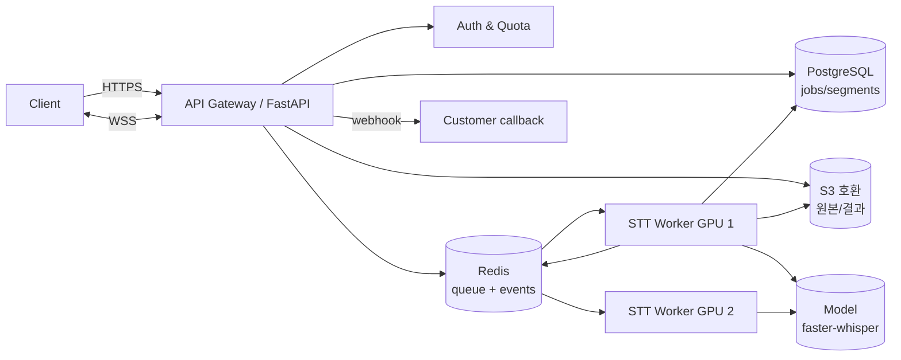

# 02. 아키텍처

## 1. 핵심 설계: 하나의 세션, 하나의 이벤트 스트림

배치와 스트리밍을 **별도 서비스로 만들지 않는다.** 둘 다 `TranscriptionSession`이며, 차이는 "오디오가 어디서 오는가"와 "이벤트를 누가 소비하는가"뿐이다.

```
                ┌──────────────────────── TranscriptionSession ────────────────────────┐
오디오 소스 ──▶ │ Decode/Resample → VAD → Segmenter → Inference → Postprocess → Events │ ──▶ Event Bus
(파일 or WS)    └──────────────────────────────────────────────────────────────────────┘
                                                                       │
                        ┌──────────────────────────────────────────────┼─────────────────────────────┐
                        ▼                                              ▼                             ▼
                 Batch collector                                Streaming writer              SSE / WS subscriber
              (모아서 최종 문서화)                            (즉시 partial/final 푸시)        (replay + live)
```

- **모든 결과는 이벤트**로 발행되고 `session_id` + `seq`로 순서가 보장된다.
- 배치 소비자는 이벤트를 모아 최종 문서를 만든다. 스트리밍 소비자는 즉시 전송한다.
- 이벤트는 Redis Stream(또는 DB outbox)에 저장 → **늦게 붙은 구독자도 리플레이 가능**.
- 따라서 "동시에"는 특수 기능이 아니라 구조의 자연스러운 결과다.

### 모드별 입력 어댑터

| 모드 | 입력 어댑터 | 종료 조건 | 결과 소비자 |
|---|---|---|---|
| Batch | 파일/URL → ffmpeg → 16 kHz mono | 파일 끝 | Collector + 폴링/웹훅/SSE |
| Streaming | WS 바이너리 프레임(16 kHz PCM16) | `end` 메시지 또는 타임아웃 | WS 즉시 전송 |
| Hybrid | Batch와 동일 | 파일 끝 | SSE (제출 시점부터 구독) |

## 2. 컴포넌트



| 컴포넌트 | 책임 | 확장 방식 |
|---|---|---|
| **API (api)** | 인증, 업로드, 잡 생성, 상태/결과 조회, WS 종료점, SSE | 무상태, 레플리카 증가 |
| **Session Hub** | WS 연결 유지, 세션별 ring buffer, 백프레셔, 이벤트 fan-out | API와 동일 프로세스(초기) → 분리 가능 |
| **Dispatcher** | 큐에서 세그먼트/잡 픽업, 우선순위·공정성, 재시도 | 경량, 다중 인스턴스 |
| **STT Worker** | 모델 로드, 마이크로배칭 추론, 결과 발행 | GPU 노드 추가 |
| **Postprocessor** | 병합, 타임스탬프 보정, 포맷 변환(SRT/VTT) | CPU, 수평 확장 |
| **Event Store** | 세션 이벤트 보관·리플레이(TTL) | Redis Streams → 대용량 시 Kafka |

> 초기에는 API와 Dispatcher를 한 프로세스로, Worker만 분리해도 충분하다. **경계는 처음부터 나눠둔다**(인터페이스/큐 기반).

## 3. 동시성 모델

요구사항의 "동시에"는 세 층으로 나눠 보장한다.

### 3.1 연결/요청 동시성 (async)

- FastAPI + uvicorn, 전 구간 `async`. WS 연결당 1개의 수신 태스크 + 1개의 송신 태스크.
- 오디오 프레임 처리는 이벤트 루프를 막지 않도록 큐를 거쳐 워커로 전달. 무거운 ffmpeg/모델 호출은 `run_in_executor` 또는 별도 프로세스.
- 요청 단위 타임아웃, 연결 단위 타임아웃, 유휴 타임아웃을 명시.

### 3.2 세션 동시성 (자원 격리)

- **전역 세마포어**: `MAX_ACTIVE_STREAMS`(예: 200), `MAX_ACTIVE_BATCH_JOBS`(예: 100).
- **테넌트 세마포어**: 키별 동시 세션/잡 상한. 초과 시 `429 quota_exceeded` (큐에 무한 대기시키지 않음).
- 스트리밍 세션은 **고정 크기 ring buffer**(예: 10초 분량). 넘치면 오래된 프레임을 버리고 `overflow` 이벤트로 알린다 → 느린 소비자가 메모리를 무한 점유하지 못함.
- 배치 잡은 파일 단위가 아니라 **청크 태스크**로 큐에 들어간다 → 큰 잡 하나가 GPU를 독점하지 않음.

### 3.3 추론 동시성 (GPU)

- GPU당 워커 프로세스 1개(모델 1회 로드). 워커 내부에서 **마이크로배칭**:
  - 준비된 세그먼트 요청을 최대 `B=8`, 최대 `T=50 ms` 동안 모아 한 번에 디코드.
  - 스트리밍 `partial`은 지연 민감 → 우선순위 높음, 배치 청크는 낮음.
- **가중 공정 큐(weighted fair queue)**: 스트리밍 : 배치 = 3 : 1 정도로 슬롯 배분. 배치가 몰려도 스트리밍 지연이 무너지지 않게.
- 공식: `동시 스트리밍 용량 ≈ GPU수 × (1 / RTF) × 안전계수(0.6)`. RTF 0.1, GPU 2장이면 이론 20배속 → 약 12 세션 안전 마진(부분 재디코딩 비용 포함해 실측으로 보정).
- **partial 재디코딩 비용**을 별도로 계상: 세그먼트가 길어질수록 비싸므로 최대 세그먼트 길이(예: 15초)와 partial 주기(예: 300~500 ms)를 제한.

### 3.4 실패 격리

| 장애 | 영향 | 대응 |
|---|---|---|
| WS 클라이언트 단절 | 해당 세션만 | 확정분 저장, 세션 `aborted` 처리, 리소스 반납 |
| Worker 프로세스 사망 | 진행 중 세션 | `error` 이벤트 후 세션 종료. 배치 청크는 재큐(멱등) |
| Redis 재시작 | 큐/이벤트 유실 위험 | AOF + 잡 상태는 PostgreSQL이 source of truth, 재시작 시 복구 스캔 |
| GPU OOM | 워커 | 세그먼트 길이 축소 재시도 1회 → 실패 시 잡 `failed` |
| 느린 다운스트림 | 세션 | 백프레셔, ring buffer drop, `slow_consumer` 통지 |

## 4. 데이터 흐름

### Batch

```
POST /v1/transcriptions
  → job row(status=queued), 원본을 S3에 저장(또는 presigned 업로드)
  → Dispatcher가 잡을 청크로 분할(무음 경계 우선)
  → 청크 태스크 N개를 큐에 등록, job.progress 갱신
  → Worker: 청크 전사 → segments 저장 + 이벤트 발행
  → 모두 끝나면 postprocess(병합/포맷) → completed → 웹훅
```

### Streaming

```
WS /v1/stream
  → ready 이벤트(session_id, 제한값)
  → 프레임 수신(20~100 ms) → 디코드/리샘플 → VAD
  → 발화 구간 누적 → partial 주기마다 디코드 → partial 이벤트
  → 무음/최대 길이 도달 → final 이벤트(확정) → 다음 세그먼트
  → end 수신 → 남은 버퍼 final → done
```

### Hybrid

```
POST /v1/transcriptions {..., "subscribe": true}  또는  GET /v1/transcriptions/{id}/events
  → 이벤트 스트림을 seq=0부터 리플레이(이미 저장된 것)
  → 이후 live 이벤트 tail
  → done 수신 시 종료
```

## 5. 기술 스택 (제안)

| 영역 | 선택 | 이유 |
|---|---|---|
| 언어 | Python 3.11+ | STT 생태계(Whisper, CTranslate2) |
| API | FastAPI + uvicorn | async, WS, OpenAPI 자동 문서 |
| STT | `faster-whisper` | GPU/CPU 모두, 양자화, 스트리밍에 충분한 속도 |
| VAD | Silero VAD | 경량, 스트리밍 친화 |
| 오디오 | ffmpeg (pyav) | 포맷/영상→오디오, 리샘플 |
| 큐/이벤트 | Redis Streams + consumer group | 가벼움, 리플레이, TTL |
| DB | PostgreSQL | 잡/세그먼트/쿼터, 트랜잭션 |
| 오브젝트 | S3 호환 (MinIO 로컬) | 대용량 원본/결과 |
| 관측성 | OpenTelemetry + Prometheus + 구조화 로그 | 추적/메트릭/로그 상관 |
| 배포 | Docker Compose(개발) → Kubernetes(운영) | GPU 노드 분리 |
| 실행 환경 | 자체 호스팅(`run.sh`) · Colab(`notebooks/`) | 동일 코드/설정, 상세는 [08-runtime-environments.md](08-runtime-environments.md) |

`Transcriber` 인터페이스(`transcribe(chunk) -> Hypothesis`)를 두어 **클라우드 STT 어댑터로 교체 가능**하게 한다. 자체 호스팅이 불가능한 환경이면 같은 API 계약을 유지한 채 어댑터만 바꾼다.

## 6. 주요 트레이드오프

| 결정 | 대안 | 선택 이유 |
|---|---|---|
| 단일 파이프라인 + 전달 계층 분리 | 배치/스트리밍 별도 서비스 | 중복 제거, 결과 일관성, 동시성 요구 충족이 쉬움 |
| WebSocket | gRPC bidi streaming | 브라우저/프록시 호환, 디버깅 용이 |
| Redis Streams | Kafka | 초기 규모에 충분, 운영 부담 낮음. 이벤트 볼륨 커지면 교체 |
| 세그먼트 단위 마이크로배칭 | 요청 단위 배칭 | 스트리밍 지연과 GPU 효율의 균형 |
| DB를 source of truth | 큐를 source of truth | 장애 복구/감사 가능 |
