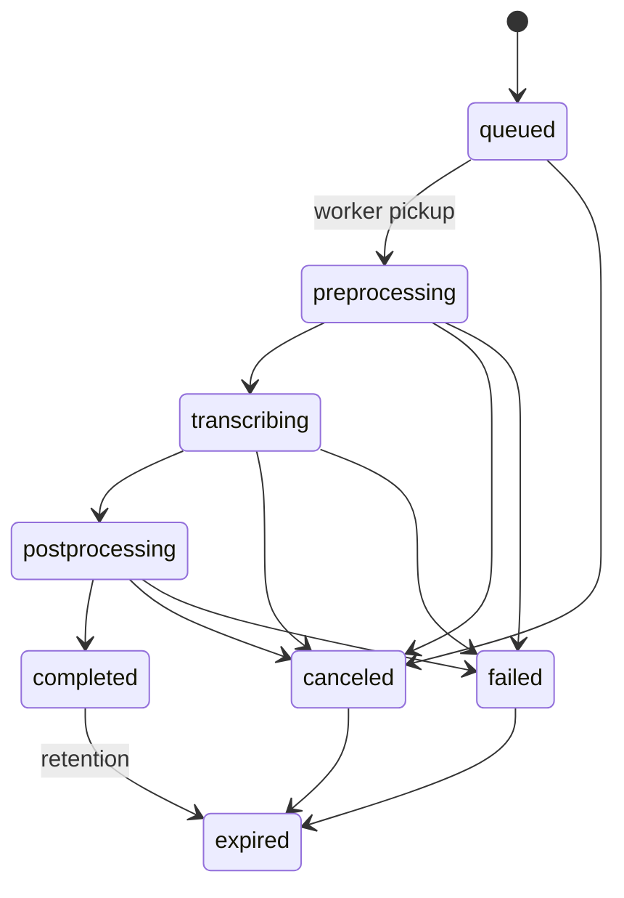

# 05. 데이터 · 운영

## 1. 상태 머신

### Batch 잡



- 상태 전이는 **조건부 UPDATE**(`WHERE status IN (...)`)로만 수행 → 중복 이벤트/재시도에 안전.
- `transcribing` 중 진행률은 청크 완료 시 갱신(1초에 1회 이하로 throttle).
- `expired`는 논리 상태. 실제 삭제는 배치 정리 작업.

### 스트리밍 세션

`connecting → active → (finalizing) → completed | aborted | failed`

- `aborted`: 클라이언트 단절/타임아웃. 확정된 `final`은 보존.
- `failed`: 워커 오류. `error` 이벤트 발행 후 종료.

## 2. PostgreSQL 스키마 (초안)

```sql
CREATE TABLE jobs (
  id              text PRIMARY KEY,              -- tr_...
  tenant_id       text NOT NULL,
  mode            text NOT NULL DEFAULT 'batch', -- batch | stream
  status          text NOT NULL,
  language        text,
  detected_language text,
  model           text NOT NULL,
  source_type     text NOT NULL,                 -- upload | url
  source_key      text,                          -- S3 key
  original_name   text,
  duration_ms     integer,
  progress        real NOT NULL DEFAULT 0,
  error_code      text,
  error_message   text,
  idempotency_key text,
  callback_url    text,
  metadata        jsonb NOT NULL DEFAULT '{}',
  created_at      timestamptz NOT NULL DEFAULT now(),
  started_at      timestamptz,
  finished_at     timestamptz,
  expires_at      timestamptz
);

CREATE UNIQUE INDEX jobs_idem ON jobs (tenant_id, idempotency_key)
  WHERE idempotency_key IS NOT NULL;
CREATE INDEX jobs_poll ON jobs (tenant_id, created_at DESC);
CREATE INDEX jobs_queue ON jobs (status, created_at) WHERE status = 'queued';

CREATE TABLE job_chunks (
  job_id      text NOT NULL REFERENCES jobs(id) ON DELETE CASCADE,
  idx         integer NOT NULL,
  start_ms    integer NOT NULL,
  end_ms      integer NOT NULL,
  status      text NOT NULL,          -- pending | running | done | failed
  attempts    smallint NOT NULL DEFAULT 0,
  audio_key   text,
  PRIMARY KEY (job_id, idx)
);

CREATE TABLE segments (
  job_id      text NOT NULL REFERENCES jobs(id) ON DELETE CASCADE,
  seq         integer NOT NULL,
  segment_id  text NOT NULL,
  start_ms    integer NOT NULL,
  end_ms      integer NOT NULL,
  text        text NOT NULL,
  confidence  real,
  words       jsonb,
  is_final    boolean NOT NULL DEFAULT true,
  PRIMARY KEY (job_id, seq)
);

CREATE TABLE stream_sessions (
  id            text PRIMARY KEY,     -- ss_...
  tenant_id     text NOT NULL,
  status        text NOT NULL,
  language      text,
  sample_rate   integer NOT NULL,
  started_at    timestamptz NOT NULL DEFAULT now(),
  ended_at      timestamptz,
  duration_ms   integer,
  error_code    text
);

CREATE TABLE api_keys (
  key_hash    text PRIMARY KEY,
  tenant_id   text NOT NULL,
  name        text,
  max_streams smallint NOT NULL DEFAULT 5,
  max_jobs    smallint NOT NULL DEFAULT 20,
  monthly_seconds bigint,
  revoked_at  timestamptz
);

CREATE TABLE usage_counters (
  tenant_id   text NOT NULL,
  period      date NOT NULL,
  audio_ms    bigint NOT NULL DEFAULT 0,
  stream_ms   bigint NOT NULL DEFAULT 0,
  PRIMARY KEY (tenant_id, period)
);
```

### 보존/삭제 정책

| 데이터 | 기본 보관 | 삭제 |
|---|---|---|
| 원본 오디오 | 7일 | S3 lifecycle + 정리 잡 |
| 결과(세그먼트/JSON/SRT) | 30일 | `expires_at` 후 배치 삭제 |
| 부분 결과(partial) 이벤트 | 10분 | Redis TTL |
| 스트리밍 오디오 버퍼 | 메모리만, 저장 안 함(옵션) | 세션 종료 시 폐기 |
| 잡 메타데이터 | 90일 | 파티션 드롭 |

- 테넌트별 보존 기간 설정 허용. 삭제 요청 API(즉시 파기)는 컴플라이언스 요구 시 추가.

## 3. Redis 키 설계

| 키 | 타입 | TTL | 용도 |
|---|---|---|---|
| `q:seg:{priority}` | Stream | - | 추론 요청 큐 (consumer group `workers`) |
| `q:job` | Stream | - | 잡 오케스트레이션(분할/후처리) |
| `ev:{session_id}` | Stream | 1일 | 세션 이벤트(리플레이) |
| `seq:{session_id}` | String | 1일 | `INCR` 이벤트 순번 |
| `active:streams` | String | - | 전역 카운터(세마포어) |
| `rl:{key}:{window}` | String | 윈도 | 레이트 리밋 |
| `lock:{job_id}` | String | 60s | 워커 중복 처리 방지 |

- Stream `MAXLEN ~ 10000`으로 무한 증가 방지(이벤트 리플레이 상한과 일치).
- Redis는 **휘발 가능**으로 취급: 잡 상태/세그먼트의 source of truth는 PostgreSQL.

## 4. 관측성

### 메트릭 (Prometheus)

| 메트릭 | 라벨 | 목적 |
|---|---|---|
| `stt_jobs_total` | status, model | 처리량/실패율 |
| `stt_queue_depth` | queue, priority | 오토스케일·알림 |
| `stt_queue_wait_seconds` | mode | 지연 원인 분리 |
| `stt_active_streams` | - | 용량 |
| `stt_rtf` | model | 엔진 효율 |
| `stt_partial_latency_ms` | model | 실시간 SLA |
| `stt_final_latency_ms` | mode | 종료 후 확정 지연 |
| `stt_gpu_utilization` / `stt_gpu_memory` | gpu | 용량 계획 |
| `stt_audio_seconds_total` | tenant | 과금/쿼터 |
| `stt_webhook_failures_total` | - | 연동 상태 |

### 로그/트레이스

- 구조화 JSON: `request_id`, `job_id`/`session_id`, `tenant_id`, `stage`, `duration_ms`.
- 오디오 본문/전사 텍스트는 **로그에 남기지 않는다**(PII).
- OpenTelemetry: API → 큐 publish → worker consume → 결과 저장을 하나의 trace로 연결(큐는 span link).
- 알림: 큐 대기 p95 > 60 s, 실패율 > 2%, 활성 스트림 > 80% 용량, 웹훅 실패율 > 10%.

### 헬스체크

- `/healthz` (liveness): 프로세스 응답만.
- `/readyz` (readiness): DB/Redis 연결, 모델 로드 완료. 로드 전 트래픽 차단.

## 5. 배포/확장

```
[api]   Deployment (CPU, HPA: CPU/RPS)
[hub]   Deployment (WS 유지, sticky 또는 Redis pub/sub으로 fan-out)
[worker] Deployment (GPU node pool, KEDA: Redis queue depth)
[post]  Deployment (CPU)
[redis] managed / StatefulSet (AOF)
[pg]    managed
[minio] managed / operator
```

- 실행 프로파일: 자체 호스팅(GPU 서버, `run.sh`)과 Colab(Pro, 노트북)을 모두 지원한다. 같은 앱·설정을 쓰고 런처만 다르다 → [08-runtime-environments.md](08-runtime-environments.md).
- **세션 허브 확장성**: WS 연결이 여러 API 레플리카에 분산되므로, 이벤트는 Redis Pub/Sub 또는 Stream으로 전달해 어느 레플리카든 구독자가 붙은 노드로 fan-out. (초기 단일 레플리카에서 시작해도 무방)
- 오토스케일: 워커는 `queue_depth / worker_throughput` 기반. GPU 노드는 콜드스타트(모델 로드 30~90 s)를 고려해 최소 1대 유지.
- 배포: 롤링. 워커는 `SIGTERM` 시 새 작업 수락 중단 → 진행 세그먼트 완료 → 종료(`preStop` 60 s). 진행 중 스트리밍은 `server_draining` 이벤트 후 확정분 저장.
- 스키마 마이그레이션: Alembic, 하위 호환 2단계(추가 → 백필 → 제거).

## 6. 보안/프라이버시

- API 키는 해시(SHA-256 + pepper)로 저장, 키 앞자리만 표시. 회전/폐기 지원.
- 업로드/결과 다운로드는 **소유자 검증** 후 presigned URL(짧은 TTL)로 제공. 버킷은 퍼블릭 금지.
- 전 구간 TLS. WS는 `wss`. 프록시 업로드 크기/타임아웃 설정을 API 한도와 일치.
- 웹훅 서명(HMAC) + 타임스탬프 윈도, 재전송 멱등 키(`X-STT-Delivery`).
- 레이트 리밋: IP + 테넌트 이중. 대용량 업로드는 별도 토큰 버킷.
- 감사 로그: 잡 생성/조회/취소/삭제, 키 변경.
- 데이터 최소화: 스트리밍 오디오 기본 미저장, 로그에 텍스트 미기록, 보존 기간 명시.
- (선택) 리전 고정/온프렘 배포 옵션 — 의료/금융 고객 요구 시.

## 7. 비용 관리

- GPU 시간이 주 비용. RTF와 배치 크기로 결정 → 모델 티어링으로 최적화.
- 배치 잡은 유휴 GPU 시간에 낮은 우선순위로 처리(야간 등), 스트리밍은 상시 용량 확보.
- 오디오는 전사 후 조기 삭제(기본 7일). 결과만 보관.
- 과금 단위: 전사된 오디오 초. 스트리밍은 세션 길이(무음 포함) 기준, 정책 문서화.
