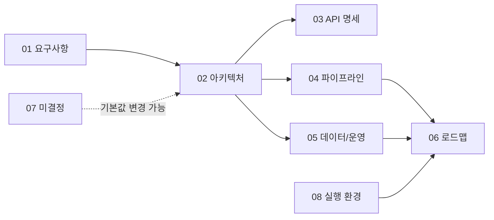
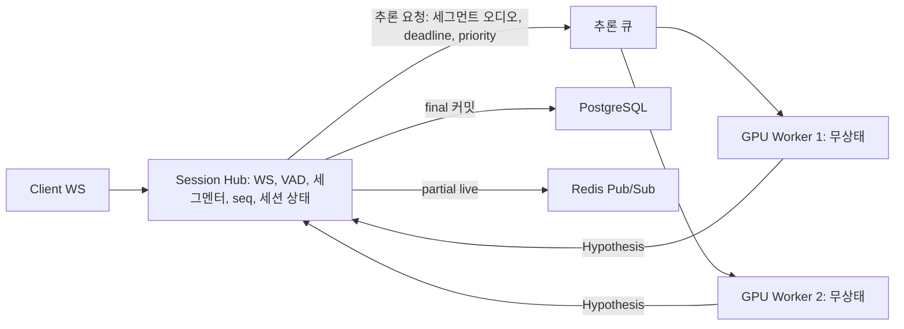

# STT API 구축 계획 검토 보고서

| 항목 | 내용 |
|---|---|
| 검토일 | 2026-11-22 |
| 검토 대상 | `plan/` 내 9개 문서 — [README](../README.md), [01](../01-requirements.md), [02](../02-architecture.md), [03](../03-api-spec.md), [04](../04-pipeline.md), [05](../05-data-and-operations.md), [06](../06-roadmap.md), [07](../07-open-decisions.md), [08](../08-runtime-environments.md) |
| 검토 범위 | **계획 문서만** 검토함. `app/`, `run.sh`, `notebooks/` 등 실제 코드는 확인하지 않음 |
| 함께 보는 문서 | [02-action-checklist.md](02-action-checklist.md) — 이 보고서의 조치 항목을 체크리스트로 정리 |

---

## 0. 총평

**한 줄 평가:** 구조와 방향은 탄탄하다. 다만 **성능·동시성 목표, 이벤트 리플레이 설계, 배치/스트리밍이 같은 GPU를 나눠 쓰는 방식**이 서로 맞물리지 않는다. M0(측정) 전에 이 세 가지를 다시 설계해야 하고, 문서 사이에 맞지 않는 수치가 20여 건 있다.

### 잘된 점 요약
- "전사 파이프라인 하나 + 전달 계층 분리"라는 핵심 개념이 처음부터 끝까지 같다.
- 요구사항에 ID(B-/S-/C-)가 붙어 있고 수용 기준(DoD), 상태 머신, 실패 격리 표, 리스크 표까지 갖춰 문서 완성도가 높다.
- "M0 실측 없이 SLA를 약속하지 않는다"는 원칙이 명시되어 있다.
- `Transcriber` 인터페이스로 엔진을 교체할 수 있게 열어 두었고, PG를 source of truth로, Redis를 휘발성으로 본 판단도 적절하다.
- 개인정보 측면(로그에 텍스트를 남기지 않음, 스트리밍 오디오 기본 미저장, 보존 기간)을 초기부터 고려했다.

### 영역별 성숙도

| 영역 | 평가 | 코멘트 |
|---|---|---|
| 요구사항 (01) | ●●●●○ | ID·수용 기준 우수. 동시성 목표의 GPU 전제가 불명확 |
| 아키텍처 (02) | ●●●○○ | 개념 우수. 스트리밍 세션 상태가 어디에 있는지, GPU 선점 방식이 빠져 있음 |
| API 명세 (03) | ●●●●○ | 예시가 풍부함. 에러/이벤트 카탈로그, WS close code, 일부 엔드포인트 누락 |
| 파이프라인 (04) | ●●●○○ | 세부 수치는 좋으나 배치 청크 단위와 추론 단위가 섞여 있음 |
| 데이터·운영 (05) | ●●●○○ | 스트리밍 결과 저장 테이블 없음. Redis 이벤트 설계가 요구사항과 충돌 |
| 로드맵 (06) | ●●○○○ | 범위에 비해 일정이 짧음(1인 6주) |
| 미결정 (07) | ●●●○○ | 항목은 적절함. 담당자·기한·선결 순서가 없음 |
| 실행 환경 (08) | ●●●○○ | 실용적. 다른 문서와 기본값 불일치가 많고 기본 보안 설정이 약함 |

### 핵심 발견 사항 (우선순위 순)

| ID | 심각도 | 요약 | 상세 |
|---|---|---|---|
| C1 | 🔴 Critical | 동시성 목표(스트리밍 100 + 배치 50)와 GPU 용량 산정이 서로 다르다. partial 재디코딩 비용은 공식보다 훨씬 클 가능성이 높다 | [§5.1](#51-c1-동시성-목표와-gpu-용량-산정의-불일치) |
| C2 | 🔴 Critical | 5~10분 배치 청크가 스트리밍 세그먼트와 같은 추론 큐에 들어가면 GPU를 오래 점유해서 우선순위 정책이 효과가 없다 | [§5.2](#52-c2-배치-청크와-추론-단위의-혼동--우선순위-무력화) |
| C3 | 🔴 Critical | Redis Streams로는 "partial TTL 10분 / final TTL 30일", "늦은 구독자가 1번부터 수신"을 구현할 수 없다 | [§5.3](#53-c3-이벤트-저장리플레이-설계가-redis-streams-특성과-충돌) |
| H1 | 🟠 High | 스트리밍 세션의 확정 세그먼트를 저장할 테이블이 없다(`segments`는 `jobs`만 참조) | [§5.4](#54-h1-스트리밍-결과-영속화-스키마-누락) |
| H2 | 🟠 High | 병렬 청크 처리가 "세션당 단일 writer" 원칙, `final` 불변 원칙과 충돌한다 | [§5.5](#55-h2-배치-병렬-청크의-이벤트-순서와-final-불변성) |
| H3 | 🟠 High | 스트리밍 세션 상태(VAD·버퍼)를 API, Hub, Worker 중 누가 소유하는지 정해져 있지 않다 | [§5.6](#56-h3-스트리밍-세션-상태의-소유-위치-불명확) |
| H4 | 🟠 High | 여러 요청을 묶는 마이크로배칭은 faster-whisper 기본 API로 바로 되지 않는다. M0 검증 항목에서 빠져 있다 | [§5.7](#57-h4-요청-간-마이크로배칭의-실현-가능성) |
| H5 | 🟠 High | 보안 공백: URL·웹훅 SSRF, 브라우저 WS에 장기 API 키 노출, 악성 미디어, 기본 무인증 | [§8](#8-보안프라이버시컴플라이언스-보완) |
| H6 | 🟠 High | 일정이 과소 추정되었다(특히 M2·M4·M5) | [§10](#10-로드맵일정-평가) |
| M* | 🟡 Medium | 백프레셔 의미 혼재, 업로드 대기 상태 없음, 에러 코드 누락, 파라미터 이름 불일치 등 | [§4](#4-문서-간-불일치-목록), [§6](#6-api-명세-보완-사항), [§7](#7-데이터-모델운영-보완-사항) |

---

## 1. 검토 방법

1. 9개 문서를 모두 읽고 요구사항(01)을 기준으로 아키텍처(02) → 명세(03) → 구현(04/05) → 일정(06/08)을 추적했다.
2. 같은 개념(수치, 이름, 상태, 한도)이 여러 문서에 나오면 서로 맞는지 대조했다.
3. 사용한 기술(Whisper/faster-whisper, Redis Streams, WebSocket/SSE)의 알려진 특성과 설계가 맞는지 확인했다.
4. 수용 기준(01 §6)을 지금 설계로 **검증할 수 있는지** 따져 보았다.

> [!NOTE]
> 아래 성능 관련 판단(예: Whisper 30초 패딩 비용)은 일반적으로 알려진 동작을 근거로 한 **추정**이다. 확정은 M0 벤치마크로 해야 하며, 검증 항목은 [§9.1](#91-m0-스파이크에-추가할-검증-항목)에 정리했다.

---

## 2. 계획 구조 이해 (요약)

- **실행 모드:** Batch(REST+폴링/웹훅), Streaming(WS), Hybrid(Batch 잡을 SSE로 구독)
- **공통 추상화:** `TranscriptionSession` → 이벤트(`partial`/`final`/`done`/`error`) + `session_id`/`seq`
- **인프라:** FastAPI · Redis(큐/이벤트) · PostgreSQL(SoT) · S3 · GPU 워커(faster-whisper) · Silero VAD
- **일정:** M0(측정) → M1(Batch) → M2(병렬/영속) → M3(Streaming) → M4(동시성) → M5(운영), 1인 약 6주
- **현재 상태(08 기준):** 인메모리 잡 러너, 에너지 VAD, API 프로세스에서 직접 추론하는 프로토타입

---

## 3. 강점 (유지 권장)

| # | 강점 | 근거 |
|---|---|---|
| 1 | 단일 파이프라인 + 이벤트 모델이라 결과 일관성(C-6)과 Hybrid를 구조적으로 확보 | README, 02 §1 |
| 2 | 조건부 UPDATE 상태 전이로 재시도·중복에 안전 | 05 §1 |
| 3 | 테넌트·전역 세마포어로 "무한 대기 대신 429"를 반환하는 명시적 실패 정책 | 02 §3.2 |
| 4 | 실패 격리 표(장애별 영향·대응) | 02 §3.4 |
| 5 | 청크 오버랩 + 단어 타임스탬프 기반 중복 제거, 병합 불변식 검증 | 04 §4 |
| 6 | 골든셋 회귀(CER 2%p 악화 시 배포 차단), 스트리밍 CER을 배치 기준으로 상대 비교 | 04 §7 |
| 7 | 웹훅 HMAC + 타임스탬프 윈도 + 전달 ID | 03 §1.6, 05 §6 |
| 8 | 로그 PII 배제, 스트리밍 오디오 기본 미저장 | 05 §4, §6 |
| 9 | Colab을 "운영 아님"으로 못 박고 같은 코드로 검증하는 경로로 한정 | 08 |
| 10 | 마일스톤마다 "동작하는 세로 조각" + 완료 기준 | 06 §1 |

---

## 4. 문서 간 불일치 목록

> 하나의 값으로 정하고 **한 곳(권장: 설정 문서 또는 07)에서만 정의한 뒤 나머지 문서는 참조**하도록 바꾸는 것을 권장한다.

| # | 항목 | 위치 A | 위치 B | 권장 |
|---|---|---|---|---|
| 1 | Python 버전 | README·02: 3.11+ | 08 §2: 3.9+ | **3.11+로 통일.** 04 §5.1의 `str \| None` 문법은 3.10+가 필요함 |
| 2 | partial 주기 | 04 §3.2: 300~500 ms | 08 §4: `STT_PARTIAL_INTERVAL_MS=700` | 700 ms로는 첫 partial p95 700 ms 목표를 맞출 수 없음. 400 ms로 통일하거나 목표를 조정 |
| 3 | 발화 종료 무음 | 04 §3.1: 500 ms | 08 §4: `STT_SILENCE_END_MS=600` | 하나로 통일 |
| 4 | 배치 청크 길이 | 04 §1 표: 5~15분 | 04 §4.1: 5~10분, 강제 10분 | 5~10분으로 통일(§5.2 참고) |
| 5 | 동시 스트림 상한 | 01: 100 / 02 §3.2: 예 200 | 02 §3.3: GPU 2장 ≈ 12 / 08: 4 | §5.1의 용량 모델로 다시 정의 |
| 6 | 동시 배치 상한 | 01: 50 / 02: 예 100 | 03: 키당 20 / 08: 4, 워커 1 | 전역과 키당 구분을 명확히 |
| 7 | VAD 방식 | 02·04: Silero | 08: 에너지 RMS(`STT_SPEECH_RMS`) | 교체 시점을 06 M3 태스크에 명시 |
| 8 | VAD 윈도 | 04 §1 표: 20~30 ms | 04 §3.1: 512샘플(32 ms) | 32 ms로 통일. 20~100 ms 입력 프레임은 재프레이밍 버퍼 필요 |
| 9 | 진행률 단위 | 01 B-2: % | 03 §1.2: 0.0~1.0 | 0.0~1.0으로 통일 |
| 10 | 타임스탬프 옵션 이름 | 03 배치: `timestamps=segment` / 결과: `include_words` | 03 WS: `word_timestamps` | `word_timestamps`(bool) 하나로 통일 |
| 11 | 모델 지정 | 04 §5.3: fast/default/accurate 티어 / 03 예시: `large-v3-turbo` | 08: 기본 `small`. API에 모델 파라미터 없음 | API에 `model`(티어) 필드 추가, 결과에 모델 버전 기록 |
| 12 | 세션 모델링 | README: "모든 전사는 `TranscriptionSession` 하나" | 05: `jobs` / `stream_sessions` 분리, `segments`는 `jobs`만 FK | §5.4 참고 |
| 13 | 백프레셔 신호 | 02 §3.2: `overflow` 이벤트 | 03 §2.1: `error` + `slow_consumer` | 이벤트 카탈로그로 통일(§6) |
| 14 | 취소 동작 | 01 B-5: 자원 점유 **즉시** 중단 | 04 §4.3: 진행 중 청크는 **완료 후** 폐기 | "취소 후 최대 N초 안에 중단"으로 요구사항 완화, 또는 청크 내부에서 취소 확인 |
| 15 | Hybrid 동작 | README: "partial도 즉시", "올리면서 앞부분부터" | 배치 경로는 partial이 없고 업로드 완료 후에야 처리 | README 표현 수정. 업로드 중 처리는 범위 밖으로 명시 |
| 16 | 이벤트 writer | 04 §6.4: 세션당 단일 writer | 02 §3.2: 배치 청크 병렬 처리 | §5.5 참고 |
| 17 | 이벤트 보존 | 04 §6.2: final은 결과 TTL(30일)까지 | 05 §3: `ev:` TTL 1일, MAXLEN 10000 | §5.3 참고 |
| 18 | 헬스/정보 엔드포인트 | 05·08: `/healthz`, `/readyz`, `/v1/info` | 03: 명세 없음 | 03에 추가 |
| 19 | 인증 기본값 | 01 NFR: API 키 인증 | 08 §5: 기본 무인증, `api_key` 쿼리 허용 | §8 참고 |
| 20 | 첫 partial 지연 기준 | 01 §4: "(발화 종료 기준)" | 04 §3.2: "프레임 도착 → partial" | 첫 partial은 **발화 시작 기준**, final은 **발화 종료 기준**으로 분리 |
| 21 | Hybrid 구독 파라미터 | 02 §4: `"subscribe": true` | 03: 정의 없음 | 삭제하거나 의미 정의(POST 응답에서 SSE로 전환하는 방식은 비권장) |
| 22 | 무음만 있는 입력 | 04 §2: batch `invalid_audio` | 01 S-3 / 일반 기대: 빈 결과 | 배치도 빈 결과 `completed`를 권장(무음 파일은 사용자 오류가 아님) |

---

## 5. 핵심 설계 이슈 상세

### 5.1 C1. 동시성 목표와 GPU 용량 산정의 불일치

**현상**
- 01 §4: "스트리밍 100 세션 + 배치 50 잡 동시, 지연 저하 20% 이하" (GPU 수 미명시, §7 가정은 "GPU 1종")
- 02 §3.3: `GPU수 × (1/RTF) × 0.6` → GPU 2장 ≈ 12 세션
- 08: 기본 `STT_MAX_ACTIVE_STREAMS=4`

**이 공식이 비용을 과소평가할 가능성이 큰 이유**
1. **Whisper 인코더는 30초 고정 윈도로 동작한다.** faster-whisper 기본 구현은 짧은 입력도 30초로 패딩한다. 그래서 1초짜리 partial도 인코더 비용은 30초 입력과 거의 같다. 04 §5.2의 길이 버킷(<3 s, <8 s, ≤15 s)은 디코더 쪽만 아낀다. large-v3-turbo는 디코더가 4층이라 비용 대부분이 인코더에서 나온다.
2. **partial은 누적 재디코딩이다.** 400 ms마다 현재 세그먼트 전체를 다시 디코드하므로 RTF 기반 "오디오 1초당 비용" 공식이 맞지 않는다. 비용은 **호출 횟수**에 비례한다.
3. **대략 추정:** 100 세션 × 발화 비율 60% × 초당 2.5회 ≈ **초당 150회 인코더 패스**. 여기에 배치 50잡이 더해진다. GPU 1장으로는 거의 불가능하다. (정확한 수치는 M0에서 측정)

**권장**
- 01 NFR을 **"GPU 1장(L4 기준)당 스트리밍 N세션 + 배치 M잡"** 처럼 단위 용량으로 고치고, 100/50은 "목표 규모 = 단위 용량 × GPU 수"로 표현한다.
- **용량·비용 모델 문서**(`09-capacity-and-cost.md`)를 추가한다. 입력: 세션 수, 발화 비율, partial 주기, 1회 추론 비용(배치 크기별). 출력: 필요 GPU 수, 월 비용.
- partial 비용을 줄이는 방안을 설계에 넣는다.
  - **2-pass:** partial은 `fast` 모델(small), final은 `default` 모델 → 04 §5.3 티어를 실제로 활용
  - **LocalAgreement 방식 증분 확정**(whisper_streaming 계열): 앞부분 가설이 안정되면 확정해서 재디코딩 범위를 줄임
  - **부하 단계별 품질 저하 순서(degradation ladder):** 부하가 오르면 partial 주기 늘리기 → partial 중단(final만) → 신규 세션 503
  - **같은 세그먼트의 낡은 partial 요청 폐기**(supersede) + 마감 시간(deadline)이 지난 요청 폐기
- 스트리밍 전용 모델 대안(예: streaming Transducer/Zipformer 계열)을 D1에 "평가 후보"로 추가하는 것을 검토한다. 한국어 품질은 확인이 필요하다.

### 5.2 C2. 배치 청크와 추론 단위의 혼동 → 우선순위 무력화

**현상**
- 04 §4.1: 배치 청크는 5~10분이고 `(index, start_ms, end_ms, audio_ref)`로 큐에 등록된다.
- 04 §5.1: `Transcriber`는 "세그먼트 15초 상한을 가정"한다.
- 04 §5.2: `ready_queue`에 `streaming partial > streaming final > batch chunk`를 **함께** 넣고 최대 8개씩 묶는다. VRAM 예산도 "8 × 15초"로 잡혀 있다.

**문제**
- 10분 청크는 RTF 0.1 기준으로 약 60초 동안 GPU를 점유한다. 그 사이 스트리밍 partial은 우선순위가 높아도 **선점할 수 없다** → 지연 목표가 깨진다.
- 10분 청크는 15초 상한 가정과 VRAM 예산에도 맞지 않는다.

**권장: 2단계 단위 분리**

| 단위 | 크기 | 용도 |
|---|---|---|
| **오케스트레이션 청크** | 5~10분 | 진행률, 재시도, 취소, 병렬 분배 단위(`job_chunks`) |
| **추론 아이템** | ≤ 30초(VAD 세그먼트) | GPU 큐에 실제로 들어가는 단위. 스트리밍과 같은 큐에서 경쟁 |

- 워커는 청크를 VAD 세그먼트(≤30초)로 쪼개 추론 큐에 넣는다. 각 아이템이 끝날 때마다 스트리밍 요청이 끼어들 수 있다(**선점 지점**).
- 배치 쪽은 `BatchedInferencePipeline`처럼 한 오디오 안의 세그먼트를 묶는 방식으로 처리량을 확보한다.
- **더 단순한 대안(초기 권장):** GPU 풀을 나눈다(스트리밍 전용 / 배치 전용). 공정 큐 구현 부담이 사라지고 지연이 예측 가능해진다. 유휴 용량 공유는 M4 이후로 미룬다. 07에 결정 항목(D12)으로 추가할 것을 권장한다.

### 5.3 C3. 이벤트 저장·리플레이 설계가 Redis Streams 특성과 충돌

**현상과 문제**

| 설계 내용 | 문제 |
|---|---|
| 04 §6.2: partial TTL 10분, final/done은 결과 TTL(30일)까지 | Redis Stream은 **엔트리별 TTL이 없다.** 키 단위 TTL만 있음 |
| 05 §3: `ev:{session_id}` TTL 1일 | 결과는 30일 보관인데 이벤트는 1일 뒤 사라짐 → 이틀 뒤 SSE 리플레이 불가 |
| 05 §3: `MAXLEN ~ 10000` | 2시간 스트리밍 × partial 2.5회/초 ≈ **18,000건** → 앞부분 이벤트가 잘려 나감 |
| 04 §6.1: `seq`를 Redis `INCR`로 발급 | Redis 재시작 시 seq가 초기화·중복될 수 있음 → `Last-Event-ID` 재개가 깨짐 |
| 01 §6: "늦은 SSE 구독자가 이벤트 1번부터 `done`까지 순서대로 수신" | 위 조건에서는 보장할 수 없음 |

**권장: 영속 이벤트와 휘발 이벤트 분리**
1. **영속 이벤트**(`status`, `final`, `warning`, `done`, `error`): PG에 저장(`segments` + `session_events` 또는 outbox). **seq는 세션 소유 writer가 발급하고 PG 유니크 제약으로 보장.**
2. **휘발 이벤트**(`partial`): Redis Pub/Sub 또는 짧은 Stream으로 **live 전용**. 리플레이하지 않는다.
3. **리플레이 = PG에서 영속 이벤트 재생 + live tail 이어 붙이기.** 경계에서 중복이 생기면 seq로 제거한다.
4. 명세에 **"리플레이는 영속 이벤트만 포함하며 seq에 빈 번호가 있을 수 있다"** 고 명시하고, 01 수용 기준 문구도 이에 맞게 고친다.

### 5.4 H1. 스트리밍 결과 영속화 스키마 누락

- S-7(단절 후 확정 결과 조회), D9(확정 세그먼트 30일 보관), 03 §3(`GET /v1/stream-sessions/{id}`)이 요구되지만, `segments.job_id`는 `jobs(id)`만 참조한다.
- **선택지**
  - (A, 권장) `jobs`를 `transcriptions`로 일반화해서 `mode = batch | stream`으로 통합하고 `stream_sessions`는 스트리밍 전용 속성만 담는 1:1 확장 테이블로 둔다 → README의 "단일 세션 모델"과 일치
  - (B) `stream_segments` 테이블을 따로 둔다 → 구현은 쉽지만 결과 조회와 포맷 변환 코드가 중복됨
- 함께 고칠 점
  - `segments` PK `(job_id, seq)`: 청크를 다시 큐에 넣으면 seq가 바뀌어 중복 행이 생긴다. **`(transcription_id, chunk_idx, local_idx)`** 또는 `segment_id` 기반 upsert로 바꿔 멱등성을 확보한다.
  - `is_final` 컬럼: partial은 DB에 저장하지 않으므로 필요 없다. 남길 거라면 용도를 정의한다.
  - `jobs.status`, `job_chunks.status` 등은 text 대신 CHECK 제약이나 enum을 쓴다.

### 5.5 H2. 배치 병렬 청크의 이벤트 순서와 final 불변성

- **순서:** 청크 3이 청크 1보다 먼저 끝나면 `final` 이벤트의 seq 순서와 시간 순서가 달라진다. 시나리오 C("앞부분부터 보기")의 UX가 깨진다.
- **불변성:** README는 "final은 이후 변경되지 않음"이라고 하지만, 청크 경계의 중복 제거와 문장 병합(04 §4.2)은 **이미 발행된 final을 바꾸는** 작업이다.
- **단일 writer:** 여러 워커가 같은 잡의 이벤트를 쓰게 되어 04 §6.4와 충돌한다.

**권장**
- 잡 이벤트의 writer는 **오케스트레이터(Dispatcher) 하나**로 정한다. 워커는 결과를 오케스트레이터에 돌려준다.
- **순서 버퍼:** 청크 k의 final은 0..k-1이 끝나고 경계 병합까지 마친 뒤 발행한다 → 순서와 불변성을 함께 보장한다.
- 또는 API 계약을 바꾼다: "배치 SSE의 `final`은 잠정이며 최종 문서(`result`)는 병합본"이라고 명시하고 `segment.revised` 이벤트를 추가한다.

### 5.6 H3. 스트리밍 세션 상태의 소유 위치 불명확

- 02 §2에서는 Session Hub가 ring buffer와 fan-out을 맡고, §3.1에서는 프레임이 "큐를 거쳐 워커로 전달"되며, 04 §6.4에서는 "Worker가 해당 세션을 소유"한다. VAD와 세그멘터가 어디서 도는지 정해져 있지 않다.
- 워커가 세션을 소유하면 워커 1개가 죽을 때 그 워커의 모든 스트림이 종료되고(02 §3.4), 오디오 프레임 전체(세션당 초당 10건)가 Redis를 거쳐야 한다.

**권장 구조**

- 세션 상태(VAD, 버퍼, seq)는 **WS가 붙은 Hub 인스턴스가 소유**한다 → 단일 writer가 자연스럽게 성립한다.
- GPU 워커는 **무상태 추론 RPC**로 둔다 → 워커가 죽어도 해당 요청만 다른 워커로 재시도하면 되므로 **세션이 유지된다**(02 §3.4의 "error 후 종료"보다 나음).
- 큐에는 VAD로 잘린 세그먼트만 들어가므로 Redis 트래픽이 크게 줄어든다.
- Hub가 죽으면 세션은 `aborted`가 되지만 확정분은 PG에 있다. 복구는 v2 `resume`으로 한다.

### 5.7 H4. 요청 간 마이크로배칭의 실현 가능성

- faster-whisper의 `WhisperModel.transcribe()`는 오디오 하나를 처리하고, `BatchedInferencePipeline`은 **한 오디오 안의** 세그먼트를 묶는다. **서로 다른 세션(언어·프롬프트가 다름)의 요청을 한 배치로 묶으려면** CTranslate2 `Whisper.generate()`에 피처 배치를 직접 넣는 저수준 구현이 필요하다. 프롬프트 길이 패딩과 언어 감지 분리도 직접 해야 한다.
- 이것은 M4 작업으로 잡혀 있지만, **안 되면 C1 용량 추정이 통째로 바뀐다.** 그래서 M0 스파이크에서 먼저 검증해야 한다.
- 대안: GPU당 모델 복제본 여러 개(VRAM 여유가 있을 때), 또는 Triton/TensorRT 계열 서빙. 검증 결과에 따라 고른다.

---

## 6. API 명세 보완 사항

### 6.1 누락된 엔드포인트

| 엔드포인트 | 이유 |
|---|---|
| `GET /v1/transcriptions?status=&cursor=` | 목록·페이지네이션. `jobs_poll` 인덱스는 있는데 API가 없음 |
| `DELETE /v1/transcriptions/{id}` | 즉시 파기(개인정보 삭제 요청 대응). 05 §2에서 "추후"로 미뤄 둠 |
| `DELETE /v1/stream-sessions/{id}` | 같은 이유 |
| `POST /v1/stream/tokens` | 브라우저용 **단기 토큰** 발급(§8) |
| `GET /healthz`, `/readyz`, `/v1/info` | 05·08에서는 언급되지만 03 명세에는 없음 |
| `GET /v1/usage` | 쿼터·사용량 조회(C-3) |

### 6.2 이벤트·에러 카탈로그 정비
- **이벤트 카탈로그 표:** `type`, 필드, 발행 주체, **리플레이 포함 여부**, 보존 기간. 지금 흩어져 있거나 빠진 타입: `status`, `warning`(04 §2), `overflow`(02), `pong`, `ready`.
- 모든 이벤트에 `session_id`(또는 `transcription_id`), `schema_version`, 서버 발행 시각 `emitted_at`을 넣는다(디버깅과 지연 측정에 필요).
- **에러 코드 표 누락:** `handshake_timeout`, `idle_timeout`, `server_draining`, `slow_consumer`, `job_not_ready`(결과 미완료 409. 지금은 `canceled`와 같은 409를 씀), `upload_incomplete`, `idempotency_conflict`.
- **WS close code 표:** 지금은 08에 4401 하나만 있다. 예: 4400 invalid_request, 4401 unauthorized, 4408 timeout, 4429 quota, 4503 draining/limit, 1011 internal.
- `quota_exceeded`가 동시성 초과와 월 사용량 초과에 함께 쓰인다 → `concurrency_limit` / `usage_limit`로 나누고 대응 방식(재시도 가능 여부)을 구분한다.

### 6.3 Batch 세부
- **업로드 대기 상태:** 옵션 C(presigned)는 `201` 후 `/submit` 흐름인데 상태 머신에 `awaiting_upload`(또는 `created`)가 없다. 업로드 만료와 방치된 잡 정리 규칙도 필요하다.
- **취소 응답:** `202`와 함께 상태를 바로 `canceled`로 할지, `canceling`을 거칠지 정한다. `failed`/`canceled` 잡을 취소하면 어떻게 되는지도 정의한다.
- **Idempotency:** 같은 키에 다른 본문이 오면 `409 idempotency_conflict`. 키 보존 기간(예: 24시간)과 multipart 본문 해시 비교 방법을 정한다.
- `estimated_completion_at` 산출 방식(큐 대기 + 길이 × RTF)을 정의하거나 "best effort"라고 표기한다.
- `profanity_filter`가 03 예시에만 있고 04 파이프라인에는 없다 → 구현 계획을 넣거나 삭제한다.
- 결과 예시의 `model`에 **모델 리비전(해시)** 과 파이프라인 버전을 넣는다(재현성).

### 6.4 Streaming 세부
- **브라우저 입력 형식(D3):** 브라우저 `MediaRecorder`의 기본 출력은 WebM/Opus이고, PCM은 AudioWorklet이 있어야 만들 수 있다. 클라이언트 가이드에 AudioWorklet 리샘플 예제를 넣거나 `encoding=opus` 지원 여부를 정한다.
- **언어 자동 감지 정책(C-1):** 400 ms 음성으로는 감지가 불안정하다. "첫 N초로 감지한 뒤 고정" 또는 "세그먼트마다 감지"를 정하고, 코드 스위칭(한·영)은 어떻게 다룰지 명시한다.
- **첫 partial 지연:** 최소 오디오 400 ms + VAD 진입 + partial 타이머 정렬 + 추론 300 ms + 배칭 대기를 더하면 p95 700 ms는 빠듯하다. 측정 기준을 "발화 시작 → 첫 partial"로 정하고, 최소 오디오가 차는 즉시 첫 partial을 내보내는 규칙을 둔다.
- `ping` 15초 권장과 함께, 서버 측 WS ping/pong(프로토콜 레벨)과 앱 레벨 ping의 역할을 나눠 적는다.

### 6.5 SSE 세부
- 프록시 유휴 타임아웃을 막기 위한 **keep-alive 주석**(`: ping`, 15초) 및 `retry:` 필드
- `Last-Event-ID`가 seq를 뜻하는지 Redis Stream ID를 뜻하는지 명시(권장: seq)

### 6.6 명세 형식
- REST는 OpenAPI, **WS/SSE는 AsyncAPI** 문서로 기계가 읽을 수 있게 만든다 → 계약 테스트와 SDK 생성에 쓴다.

---

## 7. 데이터 모델·운영 보완 사항

### 7.1 스키마
- **`tenants` 테이블 추가:** 보존 기간, 웹훅 서명 시크릿, 테넌트 단위 쿼터. 지금 쿼터는 `api_keys`에만 있어서 C-3의 "테넌트 단위"를 지원하지 못한다.
- **`webhook_deliveries`(outbox):** 웹훅 재시도 상태를 DB에 남겨야 재시작 후에도 이어서 보낼 수 있다.
- **`audit_logs`:** 05 §6에 감사 로그 요구가 있는데 테이블이 없다.
- 05 §2의 "잡 메타데이터 90일 → 파티션 드롭"인데 `jobs`가 파티션 테이블로 정의되어 있지 않다 → `created_at` 기준 월 파티션을 정의하거나 정리 잡 방식으로 바꾼다.
- `usage_counters` 갱신 방식(실시간 증가 vs 완료 시 정산)과 스트리밍 사용량을 실시간으로 집계하는 방법을 정한다.

### 7.2 가용성·복구
- 01은 **API 99.9%** 를 목표로 하지만 Redis HA(Sentinel/관리형), PG 백업, **RPO/RTO**, GPU 워커 최소 2대(단일 장애점 제거)가 정의되어 있지 않다. 스트리밍 가용성 목표는 별도로 정한다(GPU 1대 구성으로는 99.9%가 어렵다).
- 02 §3.4의 "재시작 시 복구 스캔" 절차를 구체화한다: `running` 상태로 남은 청크의 lease 만료 처리, 고아 잡 재큐.
- `lock:{job_id}` 60초 TTL보다 청크 처리가 오래 걸리면 중복 처리가 생긴다 → **lease 갱신(heartbeat)** 방식으로 바꾼다.

### 7.3 관측성
- `stt_audio_seconds_total{tenant}`: 테넌트 수가 많으면 Prometheus 카디널리티가 폭증한다 → 과금 집계는 DB나 로그 파이프라인으로 하고 메트릭에는 상위 N개만 둔다.
- **SLO와 에러 버짓**을 정의한다(예: 스트리밍 partial p95, 배치 완료 시간 p95, API 성공률). 알림은 SLO 소진 속도(burn rate) 기준으로 건다.
- 지연 측정 지점(클라이언트 프레임 송신 ↔ 서버 수신 ↔ 추론 ↔ 송신)을 정의하고, 이벤트의 `emitted_at`으로 수집한다.

### 7.4 오디오 전처리
- **영상 시작 오프셋:** mp4 edit list나 `start_time ≠ 0`인 파일은 자막 싱크가 어긋날 수 있다 → 01의 "±200 ms" 수용 기준과 직접 관련된다. 원본 PTS 기준으로 보정하는 규칙이 필요하다.
- **peak normalize:** 배치에서 하려면 전체를 한 번 훑어야 해서 "메모리 상한 고정 스트리밍 디코드"(04 §2)와 충돌한다. Whisper의 log-mel은 정규화에 민감하지 않으니 생략하거나 청크 단위로 처리할 것을 권장한다.
- "디스크 스풀 없이 청크 생성"과 "분산 워커가 `audio_key`로 청크를 가져감"이 충돌한다 → 청크는 S3나 공유 스토리지에 **저장되어야 한다.** 표현을 정리한다.
- 4시간 파일의 VAD 전체 스캔 시간을 "1시간 파일 ≤ 10분" 목표에 포함할지 정한다(측정 시작·종료 지점 정의).
- 다중 오디오 트랙이나 스테레오 통화 녹음(채널별 화자)은 어떻게 할지: 기본 다운믹스 + 옵션으로 채널 선택.

### 7.5 결과 포맷
- **자막 규칙:** Whisper 세그먼트는 최대 30초까지 길어질 수 있어 자막으로 쓰기 어렵다. 줄당 글자 수, 최대 2줄, 최대 표시 시간(예: 7초), 최소 간격 등 SRT/VTT 분할 규칙을 정한다(D7 "자막이 1차 목적인가"와 연결).
- **텍스트 정규화:** 숫자·단위 표기(ITN), 문장부호, 띄어쓰기 정책을 정한다(한국어 CER 측정 시 정규화 규칙과 같아야 함).

---

## 8. 보안·프라이버시·컴플라이언스 보완

| # | 위험 | 현재 | 권장 |
|---|---|---|---|
| S1 | **SSRF**(URL 소스, `callback_url`) | 언급 없음 | 사설/메타데이터 IP 차단(DNS 재바인딩 대비 연결 시점 검사), 리다이렉트 제한, 스킴 화이트리스트(https), 크기·시간 제한, 별도 egress 프록시 |
| S2 | **브라우저 WS에 장기 API 키** | `Sec-WebSocket-Protocol: bearer.<API_KEY>` | 서버가 발급하는 **단기·단일 용도 토큰**(예: 60초, 세션 1회)만 브라우저에 전달 |
| S3 | **쿼리스트링 `api_key`** | 08 §4 허용 | 액세스 로그와 프록시 로그에 남음 → 운영에서는 금지(개발 모드에서만) |
| S4 | **기본 무인증** | 08 §5: 기본 인증 없음 | **fail-closed:** `0.0.0.0` 바인딩이나 터널 사용 시 키가 없으면 기동 거부. localhost에서만 무인증 허용 |
| S5 | **악성·폭탄 미디어** | 언급 없음 | ffprobe로 길이와 코덱을 먼저 확인, ffmpeg 프로세스 격리(별도 컨테이너/seccomp, CPU·메모리·시간 제한), 허용 코덱 화이트리스트 |
| S6 | 저장 데이터 암호화 | TLS만 언급 | S3 SSE, PG 디스크 암호화, 백업 암호화 |
| S7 | 웹훅 시크릿 관리 | 저장 위치 없음 | 테넌트별 시크릿, 회전 지원(두 시크릿 병행 기간) |
| S8 | 웹훅 재시도 | 5회, 1→16초(총 약 30초) | 수신 측 장애에 버티기엔 너무 짧음 → 수 시간에 걸친 지수 백오프 + DLQ + 수동 재전송 API |
| S9 | 개인정보(한국 개인정보보호법) | 보존 기간만 | 음성은 개인정보 → 처리 목적과 동의 고지 책임 분담, 국외 이전(클라우드 STT 어댑터를 쓸 때) 검토, 파기 증적 |
| S10 | 레이트 리밋 우회 | IP + 테넌트 | WS 프레임 속도 제한(실시간보다 빠른 주입 방지 또는 허용 여부 정책), 업로드 토큰 버킷 |
| S11 | Colab 공개 터널 | 키 설정 권고 | 데모용 키 별도 발급 후 폐기. **Colab 이용 정책상 웹 서비스 호스팅이 허용되는지 확인 필요** |
| S12 | 의존성·모델 공급망 | 언급 없음 | 모델 다운로드 해시 고정, `requirements` 버전 고정과 취약점 스캔, 컨테이너 이미지 서명 |

> [!IMPORTANT]
> S1(SSRF), S2(브라우저 키 노출), S4(기본 무인증)는 **외부 노출 전에 반드시** 해결해야 한다. Colab 데모처럼 공개 URL을 쓰는 경우도 포함된다.

**위협 모델 문서**(STRIDE 등)를 짧게라도 추가할 것을 권장한다.

---

## 9. 품질·테스트 전략 보완

### 9.1 M0 스파이크에 추가할 검증 항목
지금 M0는 RTF, 지연, VRAM 측정 중심이다. 아래는 **설계를 바꿀 수 있는** 항목이므로 함께 검증해야 한다.

| # | 검증 항목 | 바뀔 수 있는 결정 |
|---|---|---|
| V1 | 짧은 세그먼트(1~15초)의 실제 추론 비용(30초 패딩 영향) | C1 용량 모델, partial 주기 |
| V2 | 요청 간 배치 추론(CTranslate2 `generate` 직접 호출) 가능 여부와 이득 | H4, M4 설계 |
| V3 | partial 1회 비용: small vs large-v3-turbo, 배치 1/4/8 | 2-pass 채택 여부 |
| V4 | **한국어 CER 기준선**: small / turbo / large-v3, 골든셋 기준 | T4에서 small 권장(08)이 품질 목표를 맞추는지 |
| V5 | Silero VAD CPU 비용 × 100 세션 | Hub CPU 사이징 |
| V6 | Whisper 세그먼트·단어 타임스탬프 정확도 | ±200 ms 수용 기준이 현실적인지 |
| V7 | 이전 텍스트 prompt 사용 시 환각·반복 발생률 | 04 §3.2 "prompt 전달"과 "`condition_on_previous_text=false`" 정책 정리 |
| V8 | ffmpeg 디코드와 VAD 스캔 처리량(1시간·4시간 파일) | 배치 목표 시간 구성 |
| V9 | Nginx 또는 cloudflared를 거친 WS 왕복 지연 | 지연 예산 |

### 9.2 테스트 전략 추가
- **절대 품질 목표:** 지금은 "스트리밍 vs 배치 상대 5%p"와 "회귀 2%p"만 있고, **절대 CER 목표**(예: 회의 음성 한국어 CER ≤ X%)가 없다. V4 결과를 보고 정한다.
- **골든셋 규모와 관리:** 카테고리당 5개는 통계적으로 부족하다. 시간 기준(예: 카테고리당 30분 이상)으로 정하고 **녹음 동의, 라이선스, PII 마스킹** 정책을 둔다.
- **계약 테스트:** OpenAPI/AsyncAPI 스키마 기반 응답 검증, WS 프로토콜 퍼징(잘못된 JSON, 과대 프레임, 순서 위반).
- **부하 도구 결정:** WS 오디오를 실시간 속도로 주입할 수 있는 부하 도구(k6/Locust + 커스텀)와 **부하용 오디오 코퍼스**를 준비한다.
- **장시간 내구 테스트:** 30분 soak + 2시간 세션 상한 테스트(메모리 누수, seq·MAXLEN 경계).
- **결정성:** 같은 입력 → 같은 결과(temperature fallback 끄기 등) 정책을 정하고 회귀 비교에 반영한다.

---

## 10. 로드맵·일정 평가

### 10.1 평가
- 06 §5: **1인 31일(약 6주).** 범위에는 PG·Redis·MinIO 연동, 웹훅, 멱등성, 직접 만드는 마이크로배칭 스케줄러, 가중 공정 큐, 100+50 부하 테스트, K8s·HPA·KEDA, OTel, 카오스 테스트, 골든셋 파이프라인이 모두 들어 있다.
- 특히 **M2(5일)** 에 병렬화, 병합, 취소, 재시도, 멱등성, 웹훅, 3종 인프라 연동이 몰려 있고, **M4(5일)** 에 이 계획에서 가장 위험한 작업(H4)이 있다.
- 지금 프로토타입은 인메모리 러너다(08). M1을 인메모리로 만들고 M2에서 PG/Redis로 바꾸면 **재작업이 생긴다** → 저장소 추상화나 PG를 M1부터 넣을 것을 권장한다.
- 리스크 표(06 §4)에 **일정 리스크, 인력 리스크, GPU 확보 리스크, 마이크로배칭 실현 불가 리스크**가 없다.

### 10.2 수정안 (1인 기준)

| 단계 | 기존 | 제안 | 변경 내용 |
|---|---|---|---|
| M0 | 2~3일 | **5일** | V1~V9 검증, 용량 모델 초안, 이벤트/세션 소유 구조 결정 |
| M1 | 5일 | 5일 | PG를 처음부터 도입(인메모리 러너 대체), 상태 머신, 에러 카탈로그 |
| M2 | 5일 | **8~10일** | M2a: Redis·S3·청크 병렬·병합 / M2b: 취소·재시도·멱등성·웹훅 outbox |
| M3 | 8일 | **10일** | Hub 중심 세션 구조, Silero 교체, 단기 토큰, PG 영속 이벤트 |
| M4 | 5일 | **7일** | GPU 풀 분리 또는 공정 큐, 마이크로배칭(V2 결과에 따름), 부하 테스트 |
| M5 | 5일 | **7일** | 보안 점검(SSRF·ffmpeg 격리), SLO·알림, 런북, 카오스 |
| 버퍼 | – | **15~20%** | 통합 이슈 대비 |
| 합계 | 약 6주 | **약 9~10주** | |

**6주를 유지해야 한다면 줄일 범위:** K8s/KEDA → Docker Compose + systemd로 1차 운영, presigned 업로드와 웹훅 → v1.1, Hybrid SSE → M4 이후, GPU 풀 분리로 공정 큐 구현 생략.

---

## 11. 미결정 사항(07) 정리 제안

### 11.1 선결 순서

| 시점 | 결정 | 이유 |
|---|---|---|
| **M0 전** | D1 엔진, D8 GPU 종류·수량 | 벤치마크 대상 하드웨어와 모델이 정해져야 함 |
| **M1 전** | D6 테넌시, D9 스트리밍 보관, D10 과금 단위, D4 한도 | 스키마(`tenants`, `segments`, `usage`)에 직접 영향 |
| **M3 전** | D3 스트리밍 입력 규격, D2 언어·도메인 | WS 프로토콜과 클라이언트 가이드 |
| **M4 전** | D5 결과 전달, D7 부가 기능 | 범위 조정 |

### 11.2 추가할 결정 항목

| ID | 결정 | 권장 기본값 |
|---|---|---|
| D11 | 이벤트 리플레이 범위 | 영속 이벤트(final/status/done)만, partial은 live 전용 |
| D12 | GPU 공유 vs 풀 분리 | 초기엔 분리, M4 이후 유휴 공유 |
| D13 | 배치 SSE의 final 순서·불변성 | 순서 버퍼로 시간순·불변 보장 |
| D14 | 브라우저 WS 인증 | 단기 토큰 발급 API |
| D15 | 부분 성공 정책 기본값 | `failed` + 부분 결과 조회 허용(현행 유지, 명시) |
| D16 | 자막 분할 규칙 | 줄당 글자 수·최대 2줄·최대 7초 |
| D17 | 데이터 상주·암호화 | 리전 고정 + 저장 데이터 암호화 |
| D18 | partial 전략 | 2-pass(fast partial + default final) 여부 |

- 07의 각 항목에 **담당자, 기한, 상태(제안/확정), 확정일** 열을 추가하고, 확정되면 ADR(결정 기록)로 남길 것을 권장한다.

---

## 12. 추가하면 좋을 문서·섹션

| 우선순위 | 문서(제안 이름) | 내용 |
|---|---|---|
| 높음 | `09-capacity-and-cost.md` | 용량 공식, M0 실측값, GPU 수와 월 비용 시뮬레이션 표 |
| 높음 | `10-security-threat-model.md` | 자산·위협·대응(STRIDE), SSRF·미디어·키·테넌트 격리 |
| 높음 | `03`에 이벤트 카탈로그, 에러/close code 표 + AsyncAPI 파일 | 계약을 하나의 기준으로 |
| 중간 | `11-slo-and-runbook.md` | SLO, 알림, 장애 대응 절차(워커 다운, Redis 재시작, GPU OOM, 큐 적체) |
| 중간 | `12-client-guide.md` | 브라우저 AudioWorklet 예제, 재연결·백오프 정책, partial/final 렌더링 규칙 |
| 중간 | `13-output-formatting.md` | 자막 분할, 텍스트 정규화, 타임스탬프 보정 규칙 |
| 중간 | `decisions/ADR-xxxx.md` | 07의 확정 결과 기록 |
| 낮음 | `14-test-data-governance.md` | 골든셋 수집 동의, 라이선스, PII 처리 |
| 낮음 | 용어·ID 규약 | `tr_`/`ss_`/`req_` 접두사, ULID 사용 여부, 시간 단위(ms) 규칙 |

---

## 13. 권장 다음 단계 (Top 10)

1. **M0 범위 확장:** V1~V9 검증 항목을 06 M0에 추가하고 결과를 `bench/RESULTS.md`에 기록한다.
2. **용량 모델 문서**를 만들고 01 NFR을 "GPU당 단위 용량"으로 고친다(C1).
3. **배치 청크 / 추론 아이템 2단계 분리** 또는 **GPU 풀 분리**를 결정해서 02·04에 반영한다(C2, D12).
4. **이벤트 계층 재설계:** 영속 이벤트는 PG, partial은 휘발로 나누고 seq 발급 주체를 정한다. 01 수용 기준 문구도 고친다(C3, D11).
5. **스키마 개정:** `transcriptions` 통합 또는 스트리밍 세그먼트 테이블, `tenants`, `webhook_deliveries`, `audit_logs`, 멱등 PK(H1).
6. **세션 소유 구조 확정:** Hub가 상태를 소유하고 GPU 워커는 무상태 RPC(H3).
7. **문서 간 불일치 22건 정리**(§4). 설정 기본값은 한 표에서만 정의한다.
8. **보안 필수 항목**(SSRF, 단기 토큰, fail-closed 인증, ffmpeg 격리)을 M1~M3 태스크에 넣는다(§8).
9. **03 명세 보강:** 누락 엔드포인트, 이벤트·에러·close code 카탈로그, AsyncAPI(§6).
10. **일정 재산정**(약 9~10주) 또는 범위 축소안 확정, 07에 담당자와 기한 지정(§10, §11).

---

## 부록 A. 문서별 세부 코멘트

| 문서 | 코멘트 |
|---|---|
| README | Hybrid 설명("partial도 즉시", "올리면서")을 실제 동작에 맞게 수정. 빠른 시작에 **API 키 설정을 기본 예시로** 넣기 |
| 01 | NFR의 GPU 전제 명시. 첫 partial 기준을 "발화 시작"으로. C-6 "일관됨"을 정량 정의(수용 기준의 CER 5%p와 연결). 절대 CER 목표 추가. 스트리밍 가용성 목표 분리 |
| 02 | Session Hub와 Worker의 책임 경계 다이어그램 보강. 용량 공식에 partial 호출 비용 반영. 실패 격리 표에 "Hub 장애", "PG 장애", "S3 장애" 행 추가 |
| 03 | §6 전체. 옵션 A~C 응답 코드(201 vs 202) 차이 설명. 클라이언트 예시의 `websockets` 라이브러리 버전 명시(`additional_headers`는 최신 API 이름) |
| 04 | 청크/추론 단위 분리. VAD 윈도 수치 통일. prompt 사용과 `condition_on_previous_text=false` 정책 정리. 배치 이벤트 순서 규칙. "부분 성공" 설정 위치 명시 |
| 05 | 스키마 보강(§7.1). Redis 키 설계를 이벤트 재설계에 맞게 수정. `lock` → lease. 파티션 정의. 카디널리티 주의 |
| 06 | M0 확장, 일정 재산정, 리스크 표에 일정·GPU 확보·마이크로배칭 실현성 추가. VAD 교체와 단기 토큰 태스크 추가 |
| 07 | 담당자·기한·상태 열, 선결 순서, D11~D18 추가 |
| 08 | 기본값을 04에 맞추거나 04를 갱신. Python 3.11+. fail-closed 인증. 쿼리 `api_key`는 개발 모드 한정. Colab 세션 한도와 이용 정책 재확인. 프로토타입 → 목표 구조 전환 경로(§7)를 마일스톤에 연결 |
